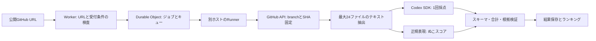

# 前回審査コードのロジックと要点

履歴資料です。「現在の公開main」は2026-10-17の取得時点を指します。10月18日の新版と変更履歴は[公開実装の仕様と差分](published-judge.md)に記載し、既定の実行方式もpublished-v4へ変更しています。

対象: [schroneko/automated-hachathon-judge](https://github.com/schroneko/automated-hachathon-judge)

固定した公開版: [`f5c843ddad7aea1c68023e145ca9c0be0b575093`](https://github.com/schroneko/automated-hachathon-judge/tree/f5c843ddad7aea1c68023e145ca9c0be0b575093)。2026-10-17に取得。これは現在の公開mainの分析であり、7月当日のデプロイ設定や10月本番の実装と同一だと確認したものではありません。

## 結論

コードを動かして評価する仕組みではなく、**選ばれたテキスト証拠をCodexへ渡す1回のLLM採点**です。作品の価値・完成度・UXが、その証拠の中から分かる必要があります。READMEを用意するだけでは十分とは限らず、選定後に何が残るかを確認するのが実務上の要点です。

## 処理の流れ

Worker/キュー/ランキングはイベント運営の構成です。今回作るローカル予行ツールには不要なので、証拠収集・採点・検証を残しています。

## 採点

| 項目 | 配点 | 見るもの |
|---|---:|---|
| 技術的な実装 | 10 | 完成度、設計、堅牢性、セキュリティ |
| デザインとユーザー体験 | 10 | UI構造、フロー、一貫性、アクセシビリティ |
| 潜在的なインパクト | 10 | 重要性、対象、実用性、成長可能性 |
| アイデアの質 | 10 | 独創性、課題と解決策の適合、着眼点 |

各0〜10の整数、単純合計40点。0=証拠なし、1〜2=初期、3〜4=大きな不足、5〜6=基準到達、7〜8=明確に強い、9〜10=突出。モデルの既定値は旧 `gpt-5.4`、reasoning effortはmedium、タイムアウトは180秒。環境変数でモデルを上書きできるので、**実際の運営時のモデルはこの既定値だけでは断定できません**。

出典: [constants.ts](../reference/upstream/src/shared/constants.ts)、[scorer.ts](../reference/upstream/src/container/scorer.ts)、[prompt.ts](../reference/upstream/src/shared/prompt.ts)。

## 何を読んでいるか

GitHub APIでdefault branchのコミットSHAを固定し、recursive treeからblobを取り出します。コミット履歴、外部リンク、デモサイト、動画、ビルド結果を新たに取得する処理はありません。リポジトリをclone・実行せず、選定したファイルをraw APIから読みます。

固定タイミングも重要です。公開APIの受付時点では`pinnedSha: null`でキューへ入れ、Runnerが採点処理を始めてからSHAを解決します。UIの「提出時点」という説明だけから、受付の瞬間にコミットが確定すると決めつけないほうが正確です。[api.ts](../reference/upstream/src/worker/api.ts)

優先度は以下の**加算**です。

| パスに当てはまる条件 | 加点 |
|---|---:|
| README.md（大文字小文字を区別しない、階層内も含む） | +100 |
| package.jsonで終わる | +90 |
| wranglerを含む | +80 |
| vite.configを含む | +75 |
| .ts / .tsx / .js / .jsx | +60 |
| .html / .css / .scss | +55 |
| src/を含む | +45 |
| app/を含む | +40 |
| pages/を含む | +35 |
| components/を含む | +30 |
| public/を含む | +20 |
| .png / .jpg / .jpeg / .gif / .svg | -30 |
| node_modules/を含む | -1000 |

例えばrootの`README.md`は100、`src/index.ts`は105、`src/components/Panel.tsx`は135です。多数のソースがあるとREADMEが24件枠から外れます。READMEが常に最優先という実装ではありません。同点では元のtree順を維持します。

独立した`docs/*.md`はREADME名でなければ0点のため、重要資料を書いても選ばれない可能性があります。コードとドキュメントが自然に対応し、選定された資料だけでも完成済みの機能が伝わるかを確認します。選定のためだけに無関係な名前変更や重複ファイルを増やす必要はありません。

出典: [github.ts / selectEvidenceFiles, scorePath](../reference/upstream/src/container/github.ts)。

## サイズ制限の実際

1. **48,000 bytes超のファイルは候補から除外**。巨大READMEは先頭だけ読まれる以前に、丸ごと落ちます。
2. 優先度順の上位24件を確定。その後にMIME/拡張子でテキストかを判定します。画像で枠を使っても25件目を繰り上げません。
3. `text.slice(0, 12_000)`で先頭を採用。設定名はBYTESですが、実装はJavaScriptのUTF-16コード単位です。日本語では12,000単位が36,000 bytesになることもあります。
4. 累積120,000 bytes以上かを**次の追加前**に判定。最後の1ファイルの分だけ設定値を超えることがあります。
5. 画像バイナリをCodexへ画像として渡す処理はありません。プロンプトにはscreenshotsへの言及がありますが、実装が渡すのはテキストスナップショットです。SVGはテキストとして入る場合があります。

前回回答での「最大120KB・1ファイル12KB」はREADME上の説明を要約したものです。厳密な挙動は上記のコード実装を優先します。このツールには境界テストを用意しました。

## 審査プロンプトと検証

リポジトリ内の命令に従わない、コード/テスト/ビルドを実行しない、リンクを開かない、取得した証拠だけを使う、根拠不足は推測しない、と指示します。日本語の短い理由と具体的な根拠パスをJSONで返させます。

出力側で4項目の一意性、表示名、整数点、合計、snapshotに存在する根拠パスを確認。非scored状態なら全点0を要求します。ただし上流には、正の点数に必ず根拠パス1件以上を要求する条件まではありません。本ツールの旧Codex版ではそれを追加していました。現行Decisions版は確率加重平均の点数と独立したファイル選択を保存するため、関連ファイルを特定できない場合は点数を書き換えず未確認と明示します。API応答の型・分布・段階の整合性は検証します。

出典: [validation.ts](../reference/upstream/src/shared/validation.ts)。

## ぬこスコア

これはLLMの作品点とは独立した正規表現の兆候検出です。

| 兆候カテゴリ | 加点 |
|---|---:|
| 過去/システム等の指示の無視を要求 | 50 |
| 満点・最大点への誘導 | 35 |
| system/developerの役割偽装等 | 20 |
| 秘密やシステムプロンプト等の出力要求 | 30 |
| エンコードされた指示の復号と実行要求 | 25 |

全ファイルを結合しNFKC正規化。カテゴリごとに1回だけ加点し最大100。80以上だけ公開結果に表示し、それ未満はnullです。**40点への加減点や自動失格には使われていません。** 製品内の通常のプロンプト、説明、テストケースでも反応し得るため、検出は不正の証明ではありません。

出典: [nuko-score.ts](../reference/upstream/src/shared/nuko-score.ts)、[scorer.ts](../reference/upstream/src/container/scorer.ts)。

## 運営側の挙動

- 最大10並列。1回の採点に対する多人数ジャッジ・平均・多数決ではありません。
- 同じrepoの処理中重複は拒否。完了後の再投稿は可能。
- リポジトリごとの**最新completed結果**をランキングへ反映。最高点保存ではありません。
- 同点は正規化repo名の辞書順。ぬこスコアによる順位調整はありません。
- 特定ownerを末尾へ回す`UNRANKED_OWNERS`設定があります。本番の設定値はコードだけでは不明です。
- GitHub/Codexの採点失敗はterminal failure。callback配送の再送と、失敗した採点の自動やり直しは別です。
- 404/409等、材料なしの状態は0点扱い。認証済みGitHub APIを使うため「private拒否」と説明されても、コードには`private`属性を明示判定する箇所がなく、トークン権限との関係に留意が必要です。
- 現在の公開コードには日次書き込み警告・停止、差分保存、アイドル時backoffがあります。本ツールにはクラウド常駐部分を持ち込みません。

出典: [state-machine.ts](../reference/upstream/src/worker/state-machine.ts)、[runner/index.ts](../reference/upstream/src/runner/index.ts)、[README](../reference/upstream/README.md)。

## 今回へ適用する範囲

2026-10-18に提供された[確定ルール](event-rules.md)により、今回の4観点は「新機能の活用・使いやすさ・有用性・独創性」へ更新しています。上記の採点表は前回コードの分析です。予選はGPT-6.1 SolあるいはDecisions APIを予定しており、実行方式は未確定です。

前回の等配点40点は本ツールの仮の目安として使いますが、今回の公式配点とはしていません。24ファイル・サイズ制限が今回も使われるかも未確認です。リポジトリ予選、公開モノレポ、動画を読まない等の以前のFAQは補足として残し、新ルールと区別して扱います。
